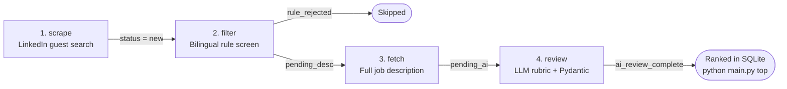

# job-match-ai

An end-to-end Python pipeline that collects LinkedIn job postings, pre-screens them with fast bilingual (EN/FR) rules, fetches full descriptions, and ranks each role against a plain-text résumé using schema-constrained LLMs via OpenRouter.

Built to cut through noisy job boards: across **4,100+ scraped postings**, deterministic rules filtered out **51%** of irrelevant or senior roles at zero API cost before scoring **1,000+ candidates** with structured LLM reviews.

---

## Architecture & Pipeline State Machine

Every job lives in a local SQLite database (`data/jobs.db`) and moves through an explicit status state machine, so any stage can be interrupted and resumed without repeating work:



| Stage | Module | What it does |
| :--- | :--- | :--- |
| **`scrape`** | [`job_match/scraper.py`](job_match/scraper.py) | Paginates through configured LinkedIn guest search queries, deduplicates against seen IDs, and upserts job metadata (`first_seen_at` / `last_seen_at`). |
| **`filter`** | [`job_match/filters.py`](job_match/filters.py) | Cheap deterministic pre-screen before making detail requests or LLM calls. Normalizes Unicode accents (`Développeur` → `developpeur`) and applies word-boundary regexes for seniority, non-tech roles, internships, company blacklists, and commute geography. |
| **`fetch`** | [`job_match/descriptions.py`](job_match/descriptions.py) | Downloads full job descriptions for `pending_desc` postings and records granular failure states (`description_failed_404`, `description_missing`, `request_exception`). |
| **`review`** | [`job_match/review.py`](job_match/review.py) | Prompts an LLM via OpenRouter with the candidate's résumé and a strict 1–100 ATS rubric, validates JSON responses against a Pydantic schema, and falls back across configured models on timeouts or provider outages. |

---

## Engineering Highlights

- **Resumable SQLite state machine** ([`job_match/db.py`](job_match/db.py)): Every transition commits immediately. Pressing `Ctrl+C` or hitting a rate limit preserves all progress, and schema migrations run automatically on startup.
- **Hard wall-clock deadline on LLM calls** ([`job_match/llm_gateway.py`](job_match/llm_gateway.py)): HTTP read timeouts only fire when a socket is completely idle, so a slow streaming trickle can hang a batch indefinitely. `call_with_deadline()` wraps blocking SDK calls in a daemon worker with a queue timeout to enforce a strict per-call deadline before failing over to the next model.
- **Adaptive rate-limit throttling** ([`job_match/throttle.py`](job_match/throttle.py)): Randomized jitter between requests with periodic longer pauses. A single `HTTP 429` cools down for 5 minutes and switches the run from fast pacing to slow pacing; repeated `429` or `403`/`999` responses abort cleanly to protect the client IP.
- **Zero personal data in code**: Search queries, location lists, scoring rubrics, and the résumé live in gitignored `config.toml` and `resume.txt` files (with committed `*.example` templates).

---

## Quickstart

### 1. Install dependencies

Requires **Python 3.11+** (uses standard-library `tomllib`).

```bash
python -m venv .venv
# Windows
.venv\Scripts\activate
# macOS / Linux
source .venv/bin/activate

pip install -r requirements.txt
```

### 2. Configure your profile & API key

Copy the example templates and fill in your own details (all three target files are gitignored):

```bash
cp config.example.toml config.toml
cp resume.example.txt resume.txt
cp .env.example .env
```

- **`.env`**: Set `OPENROUTER_KEY` (free-tier models on [OpenRouter](https://openrouter.ai/) work out of the box).
- **`resume.txt`**: Paste your plain-text résumé.
- **`config.toml`**: Customize `[[searches]]`, `[filters]` location lists, `[candidate]` rubric targets, and `[llm]` model fallback order.

### 3. Run the pipeline

```bash
# Run all four stages end-to-end (scrape -> filter -> fetch -> review)
python main.py run

# Or run individual stages
python main.py scrape
python main.py filter
python main.py fetch
python main.py review

# Inspect pipeline counts and top-ranked matches
python main.py status
python main.py top --min-score 75 -n 10
```

---

## Sample Output

```text
$ python main.py status
rule_rejected                    2136
ai_review_complete               1031
pending_desc                      899
pending_ai                        102
description_failed_status_error     2
request_exception                   2
description_failed_404              1
total                            4173

$ python main.py top --min-score 85 -n 2
[ 90] Health Informatics Analyst @ Alignerr (Montreal, Quebec, Canada)
      https://ca.linkedin.com/jobs/view/health-informatics-analyst-at-alignerr-4474557706
      Strong match: hands-on LIMS and biological sample traceability experience directly
      aligns with healthcare data workflows, backed by Python, SQL, and data analysis
      coursework.

[ 85] Ingénieur logiciel @ FDM Group (Montreal, Quebec, Canada)
      https://ca.linkedin.com/jobs/view/ing%C3%A9nieur-logiciel-at-fdm-group-4477467358
      Meets all entry-level software engineering requirements with Python, Java, C++, and
      SQL proficiency plus production LIMS experience; no critical gaps identified.
```

> **Tip:** Once you apply to or pass on a job, you can set `human_status = 'Applied'` or `'Passed'` in `data/jobs.db` to hide it from `python main.py top`.

---

## Project Structure

```text
.
├── job_match/
│   ├── config.py        # TOML loader, dataclass section binding, lookback date resolution
│   ├── db.py            # SQLite connection, idempotent schema creation & auto-migration
│   ├── throttle.py      # Adaptive request pacing and HTTP 429 / 403 / 999 guards
│   ├── scraper.py       # LinkedIn guest search pagination & HTML card parser
│   ├── filters.py       # Bilingual (EN/FR) accent-normalized rule filter
│   ├── descriptions.py  # Job description fetcher & status classifier
│   ├── schemas.py       # Pydantic schema for structured LLM output
│   ├── prompts.py       # System & user prompt templates
│   ├── llm_gateway.py   # OpenRouter client with wall-clock deadline & model fallback
│   └── review.py        # Batch LLM scoring orchestration
├── tests/               # Unit tests (unittest, zero network calls)
├── main.py              # CLI entry point
├── config.example.toml  # Example configuration
├── resume.example.txt   # Example plain-text résumé
├── .env.example         # Example environment file
└── requirements.txt
```

## Running Tests

The test suite uses Python's built-in `unittest` module and mocks all HTTP/database I/O:

```bash
python -m unittest discover -s tests -t . -v
```

---

## Disclaimer

This project is provided for **personal and educational use**. Automated scraping may violate LinkedIn's User Agreement; use conservative rate-limit settings, only query what you need for personal job searching, and respect site terms of service.

## License

Released under the [MIT License](LICENSE).
